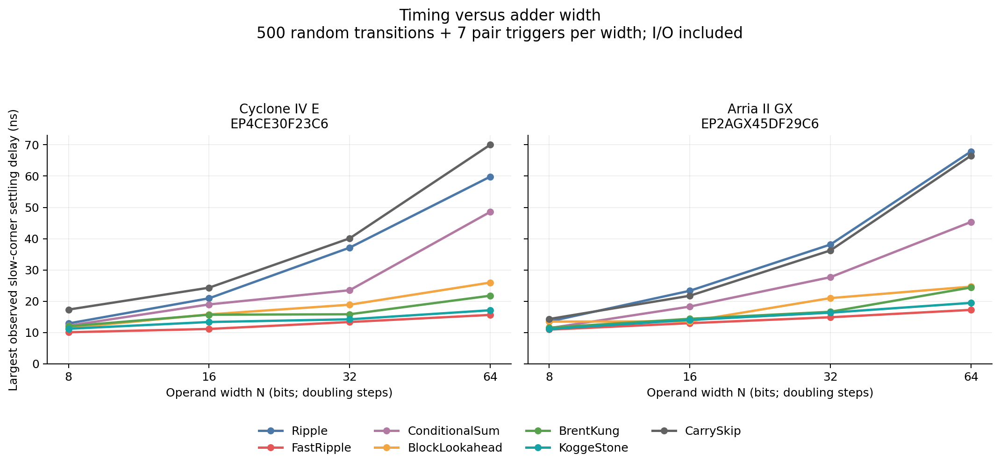
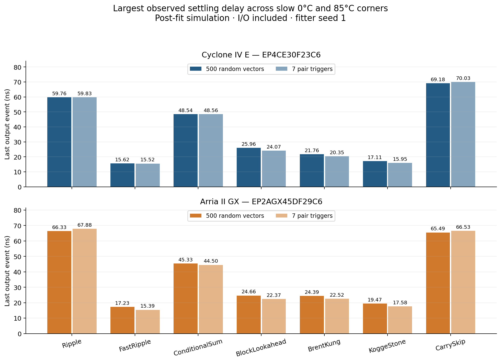
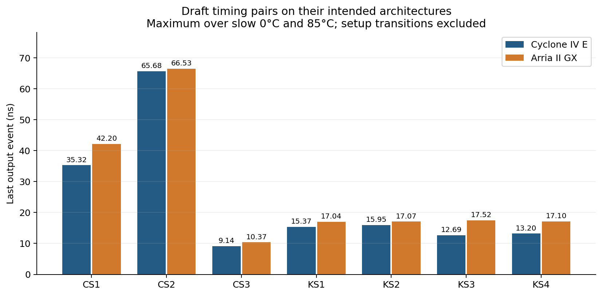
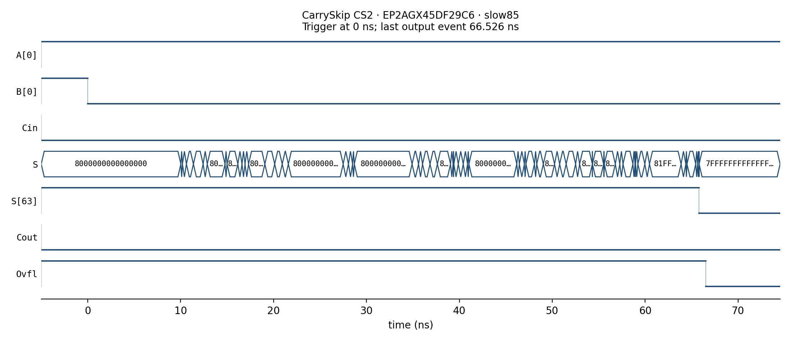
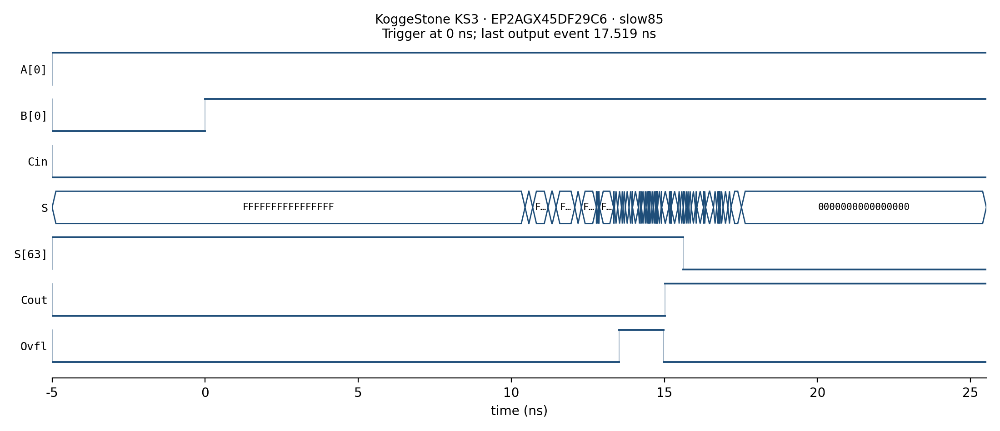

# Arad DP2.1: test-vector handoff

Prepared 2026-11-21 on `arad/test-vectors`. The deliverables are a standard-library
Python generator/checker, 500 functional vectors, and seven timing-pair drafts
(three CarrySkip, four KoggeStone). Madden chooses the final timing vectors and
wires the functional file into the testbench.

The sections below first record the original vector handoff. The later
**Compiled timing results** section records the user-authorized compilation,
simulation, workbook, figures, and reproducible workflow extension.

## Running the code

From the repository root:

```text
cd Simulation/TestVectors
python3 GenAdderVectors.py --seed 350 --count 500 --out ../AdderRandom.tvs
python3 GenAdderVectors.py --check ../AdderRandom.tvs
python3 GenAdderVectors.py --check ../Adder00.tvs
python3 GenAdderVectors.py --timing-out TimingVectorsDraft.tvs
python3 GenAdderVectors.py --check TimingVectorsDraft.tvs
```

The delivered random file uses **seed 350, count 500**, generated with Python
3.11.0. The generator prints the seed, count, and category counts. A local
`random.Random(seed)` controls every random choice and the final shuffle.
ASCII encoding, uppercase padded hex, and explicit LF newlines make repeated
runs byte-identical across newline conventions. Keep the Python version and
generator version fixed when reproducing the archived sequence.

Both output modes use the same `expected()` and `format_vector()` functions.
`expected()` computes the unbounded unsigned total, masks its low 64 bits for S,
shifts by 64 for Cout, and compares operand/result sign bits for Ovfl. No generated
vector deliberately fails. Each file has exactly six fields per line and no
comments or blank lines. Output paths are relative to the working directory;
their parent directories must exist, and an existing output file is overwritten.
`--check` returns 0 for a nonempty passing file, 1 for mismatches/malformed or empty
files, and 2 for file-access/encoding errors. Argument errors also return 2.

## Distribution and count justification

| Category | Count | Construction and purpose |
| --- | ---: | --- |
| Uniform | 200 (40%) | Independent random 64-bit A/B and one-bit Cin; broad operand, sign, and flag combinations. |
| Long propagate | 125 (25%) | Random generate position 0–15: force A=B=1 there, then complementary operands at every higher bit. This forces 48–63 consecutive propagate bits through Cout; lower bits and Cin remain random. |
| Near overflow | 100 (20%) | Cycle A around `7FFFFFFFFFFFFFFF`, `8000000000000000`, and `FFFFFFFFFFFFFFFF`, with offsets −16…16 modulo 2^64. Alternate B between a small signed value −32…32 and a randomly selected anchor with offset −16…16. Random Cin tests threshold crossings and nearby non-overflows. |
| Boundary stop | 75 (15%) | Cycle a seeded shuffle of the 18 boundaries `{1,2,4,8,12,…,60,64}`. Generate at a random bit below the boundary, propagate up to it, and force A=B=0 at the boundary to stop the carry. At 64 the carry exits as Cout; there is no bit 64 to kill it. Other bits and Cin remain random. |

For other positive counts, largest-remainder rounding preserves the requested
total and approximates these shares (ties follow table order). Category labels
describe how a vector was constructed; their arithmetic properties can overlap.

**Why 500 is sufficient for this supplementary regression:** 300 directed
random vectors repeatedly exercise structures that uniform sampling rarely
reaches. The delivered 125 long runs include every origin 0–15, with 3–14
examples per origin. The boundary schedule assigns four or five vectors to
each of 18 boundaries, covering all internal four-bit block boundaries and
power-of-two spans 1, 2, 4, 8, 16, 32, 64. The near-overflow category gives
33–34 examples around each A anchor, including 17 positive signed overflows
and 18 negative signed overflows. The 200 uniform vectors provide additional
variety and produce all four `(Cout, Ovfl)` combinations. Every category includes
both Cin values. There are 499 unique input triples among the 500 rows; the one
repeat is retained to preserve the simple, reproducible category schedule.

These are explicit coverage targets, not an exhaustive proof over the 2^129
input combinations or a measured fault-detection guarantee. The existing 16
correct directed vectors remain useful. At the current testbench's 11 ns per
vector, 500 vectors add only 5.5 microseconds of simulated time per design
(wall-clock runtime is simulator-dependent). If later RTL runs expose a bug,
retain that case and increase the count or add targeted coverage.

## Checks performed

- `Adder00.tvs`: **16 pass, exactly one mismatch on line 17**, no malformed lines;
  exit status 1 as intended. `1 + 1 + 0` recomputes to
  `S=0000000000000002, Cout=0, Ovfl=0`; line 17 stores S=`0000000000000003`.
- `AdderRandom.tvs`: **500/500 pass**. `TimingVectorsDraft.tvs`: **14/14 pass**.
- An independent, in-memory bit-by-bit full-adder calculation verified S, Cout,
  and carry-into-sign XOR carry-out for all 514 delivered rows and 10,000 extra
  random inputs. A signed-integer range check also verified overflow on those
  extra inputs. This adds evidence beyond reusing the generator as its own oracle.
- Actual CLI regeneration produced identical bytes; a different seed changed
  the vectors. Checked count rounding at 1, 2, 3, 19, 20, 21, 499, 500, and 501.
  Checker probes rejected empty files, blank lines, comments, lowercase/short
  hex, invalid bit fields, extra fields, and independently corrupted S/Cout/Ovfl;
  accepted LF, CRLF, and tab separators. Invalid count and missing-file CLI
  errors returned 2. These checks ran without adding test/build files.

Random-file SHA-256:
`33f83d5a45a7c9783f04a3f357de04fc016cab1c26380af789fc0add268336e4`.
This hashes the generated LF file; Git's local automatic CRLF checkout setting
can change file bytes. Regenerate with the command above before comparing hashes.

These initial checks validated the vector data and Python code. At that initial
handoff, no VHDL simulation, post-fit timing measurement, or Quartus run had been
performed. The compiled results below supersede that initial validation status.

## Timing drafts and path reasoning

Each table vector is the complete six-field row `A B Cin S Cout Ovfl`. File lines
are consecutive setup/trigger pairs in this table's order. Each trigger changes
exactly one input bit. Measure only its transition from the settled setup;
transitions between separate pairs are not candidate measurements.

| Pair / file lines | Setup vector | Trigger vector | Path exercised and reason to compare |
| --- | --- | --- | --- |
| CS1 / 1–2 | `7FFFFFFFFFFFFFFF 0000000000000000 0 7FFFFFFFFFFFFFFF 0 0` | `7FFFFFFFFFFFFFFF 0000000000000001 0 8000000000000000 0 1` | B(0) rises, generating carry at bit 0. Carry ripples through bits 1–3, skips blocks 1–14, then ripples through bits 60–62 to S(63). Bit 63 kills carry, so Cout stays 0 and Ovfl rises. Both endpoint blocks have block-propagate=0 in the trigger. This combines the long skip chain with endpoint ripple delay and the final sum XOR. |
| CS2 / 3–4 | `7FFFFFFFFFFFFFFF 0000000000000001 0 8000000000000000 0 1` | `7FFFFFFFFFFFFFFF 0000000000000000 0 7FFFFFFFFFFFFFFF 0 0` | Reverse CS1: remove the low-bit generate and measure falling carry through the same route to S(63)/Ovfl. Different rise/fall delays and settling of the parallel ripple/skip terms may make this slower than CS1. Cin remains 0. |
| CS3 / 5–6 | `F000000000000000 0000000000000000 0 F000000000000000 0 0` | `F000000000000000 1000000000000000 0 0000000000000000 1 0` | B(60) rises, generating carry at bit 60 and rippling through bits 61–63 to Cout. Block 15's propagate becomes 0 and its incoming carry is 0, so its skip term cannot supply the output. Compare the final block's local ripple-to-Cout path with CS1/CS2's long path to S(63); this is a non-skip candidate, not a claim that four bits must be slower than the long chain. |
| KS1 / 7–8 | `FFFFFFFFFFFFFFFF 0000000000000000 0 FFFFFFFFFFFFFFFF 0 0` | `FFFFFFFFFFFFFFFF 0000000000000000 1 0000000000000000 1 0` | Full propagate, Cin rises. Cin drives all 64 carry-combination terms plus c(0); all sum bits and Cout change. Tests large fan-out/routing load and final sum XOR versus direct Cout. The prefix network is already settled, so this transition does not traverse six prefix merges. |
| KS2 / 9–10 | `FFFFFFFFFFFFFFFF 0000000000000000 1 0000000000000000 1 0` | `FFFFFFFFFFFFFFFF 0000000000000000 0 FFFFFFFFFFFFFFFF 0 0` | Reverse KS1; compares falling carry and rising sum delays under the same high fan-out, including Cout's falling transition. |
| KS3 / 11–12 | `FFFFFFFFFFFFFFFF 0000000000000000 0 FFFFFFFFFFFFFFFF 0 0` | `FFFFFFFFFFFFFFFF 0000000000000001 0 0000000000000000 1 0` | B(0) rises: g(0) rises while p(0) falls. With Cin=0, the generated carry spreads through the G-prefix network to high sums and Cout. The g(0)-to-Gpre(63) path crosses six merges; distributed prefix wiring and reconvergent paths distinguish it from KS1's direct Cin fan-out. |
| KS4 / 13–14 | `FFFFFFFFFFFFFFFE 0000000000000000 1 FFFFFFFFFFFFFFFF 0 0` | `FFFFFFFFFFFFFFFF 0000000000000000 1 0000000000000000 1 0` | A(0) rises, turning a bit-0 kill into propagate while Cin=1. All generate bits remain zero. The change spreads through the P-prefix network (six merges to Ppre(63)), enables the carry-combination terms, and changes every sum bit/Cout. Compare P-network delay with KS3's G-network delay and KS1's already-settled prefixes. |

The actual CarrySkip RTL uses `rCOut(k) OR (BP(k) AND cb(k))`, rather than an
exclusive mux. When BP=1, the ripple and skip terms can both affect settling.
A stable block with BP=0 cannot propagate an incoming carry through all four
bits: its non-propagating bit either generates or kills carry. Thus a supposed
64-bit incoming-carry ripple through 16 disabled skip blocks is not a valid
sensitized path. CS1/CS2 sensitize the long path to the sign sum; CS3 explicitly
tests local non-skip ripple through the final carry-out.

KoggeStone has six network stages at N=64, but low prefixes and individual paths
can pass through stages without merging. Six stages alone do not identify the
slowest transition. Compare high sum outputs (with a final XOR), Cout, and Ovfl
after fitting, including routing, fan-out, polarity, and final settling after
glitches. The table gives candidates, not measured timing rankings.

**Integration detail:** `TBAdder.vhd` currently applies X to A/B/Cin for 1 ns
before every row. It therefore does not preserve a binary setup-to-trigger
transition. Madden's later timing harness must hold each setup until settled,
then apply its trigger directly and allow enough time for the post-fit outputs
to settle. Simply changing the vector filename in the current testbench is
insufficient for these timing measurements. The testbench was left unchanged.

## Contribution record and handoff

The AI agent inspected the project source, configurations, testbench, existing
vectors and relevant simulation scripts/transcripts; implemented the generator
and checker; generated both vector files; selected and explained the timing
pairs; ran the Python checks above; and wrote the initial report. That handoff
added only the four files authorized in `arad.md`. Existing design/testbench/project files
were not edited.

Arad requested the repository/task review and execution. No independent manual
review, code authorship, simulation, or timing check by Arad has been reported
in this session; this report does not attribute those activities to him. Before
presenting the work, Arad should personally trace a generate/propagate/kill
example, explain Cout versus Ovfl and the four distributions, and walk through
each setup-to-trigger pair and the testbench X issue. Record that review only
after it happens. Madden retains final selection/integration of the drafts.
The later user-authorized timing work is documented below; no remote push is
part of this handoff.

<!-- WIDTH_TIMING_RESULTS -->
## Bonus: timing versus operand width

The timing-only extension compares **N = 8, 16, 32, 64** for all seven topologies on both devices. The 64-bit baseline below is retained exactly. The 42 additional fits and 126 additional post-fit simulations passed; including the baseline, **56 fits, 168 simulations and 86,352 vector checks** were validated, with every recorded delay cross-checked against its VCD waveform. Cost analysis is outside this bonus section.

Each width uses 500 seed-350 mixed vectors plus seven reconstructed setup/trigger pairs. Sign boundaries use bit N-1, full propagation uses N bits, and CS3 moves to the top four-bit block. CarrySkip has N/4 blocks (zero middle skip blocks at N=8); KoggeStone has log2(N) prefix stages. The same generic testbench reads `vectors_N<width>.tvs`. These powers of two also satisfy the recursive implementations and four-bit CarrySkip blocks.

The table and graph show the **largest observed settling delay in ns** across the two slow corners, using the 500 random transitions and seven pair triggers. The metric and tool settings match the baseline; setup transitions are excluded from maxima. Each width is fitted independently with seed 1 and automatic pins, so I/O and routing contribute. These samples do not prove exhaustive worst-case timing or a continuous trend; connecting lines are visual guides.

| Device family | Topology | 8 bits (ns) | 16 bits (ns) | 32 bits (ns) | 64 bits (ns) |
| --- | --- | ---: | ---: | ---: | ---: |
| Cyclone IV E | Ripple | 12.890 | 20.933 | 37.128 | 59.825 |
| Cyclone IV E | FastRipple | 10.076 | 11.133 | 13.352 | 15.617 |
| Cyclone IV E | ConditionalSum | 12.165 | 18.975 | 23.513 | 48.564 |
| Cyclone IV E | BlockLookahead | 11.439 | 15.788 | 18.876 | 25.962 |
| Cyclone IV E | BrentKung | 11.986 | 15.689 | 15.825 | 21.762 |
| Cyclone IV E | KoggeStone | 11.196 | 13.353 | 14.214 | 17.109 |
| Cyclone IV E | CarrySkip | 17.321 | 24.322 | 40.101 | 70.029 |
| Arria II GX | Ripple | 13.511 | 23.332 | 38.113 | 67.875 |
| Arria II GX | FastRipple | 10.926 | 12.980 | 14.870 | 17.227 |
| Arria II GX | ConditionalSum | 11.373 | 18.281 | 27.678 | 45.331 |
| Arria II GX | BlockLookahead | 13.478 | 13.559 | 20.994 | 24.658 |
| Arria II GX | BrentKung | 11.541 | 14.373 | 16.621 | 24.393 |
| Arria II GX | KoggeStone | 11.103 | 14.014 | 16.341 | 19.468 |
| Arria II GX | CarrySkip | 14.309 | 21.739 | 36.227 | 66.526 |



For Cyclone IV E, **FastRipple** has the lowest observed maximum at all four widths; no change of the fastest topology was observed.

For Arria II GX, **FastRipple** has the lowest observed maximum at all four widths; no change of the fastest topology was observed.

On Arria II GX, the sampled ordering of BlockLookahead and KoggeStone reverses over the 8-16 and 16-32 bit intervals. More widths would be needed to locate any exact break-point; this does not change the overall winner above.

[Timing workbook with editable charts](../Documentation/TimingResults/WidthSweep/AdderWidthTimingResults.xlsx) · [Compact table CSV](../Documentation/TimingResults/WidthSweep/width_comparison.csv) · [Per-corner results](../Documentation/TimingResults/WidthSweep/corner_summary.csv) · [All measurements](../Documentation/TimingResults/WidthSweep/measurements.csv) · [Linux workflow and pair reconstruction](../Simulation/Timing/README.md#bonus-repeat-the-timing-experiment-at-several-widths)

The AI agent generalized the workflow, ran and validated the additional timing simulations on the installed Windows tools, and generated these results. The documented reproduction commands use Linux/Bash. No manual validation by Arad or cost work is claimed. Quartus and ModelSim build products remain ignored.
<!-- END_WIDTH_TIMING_RESULTS -->

<!-- COMPILED_TIMING_RESULTS -->
## Compiled timing results — 2026-11-21

Targets: **Cyclone IV E `EP4CE30F23C6`** and **Arria II GX `EP2AGX45DF29C6`**. The earlier EP4CE115 target was superseded and is excluded from these results.

All **14 fits** and **42 post-fit simulations** completed. All **21,588 vector checks passed** (514 rows × 7 architectures × 2 devices × 3 corners). Each run confirmed successful SDF back-annotation, and every measured output-event time was independently cross-checked against its VCD waveform.

[Excel workbook](../Documentation/TimingResults/AdderTimingResults.xlsx) · [Design summary CSV](../Documentation/TimingResults/design_summary.csv) · [Corner table](../Documentation/TimingResults/corner_summary.csv) · [All measurements](../Documentation/TimingResults/measurements.csv) · [Run the workflow](../Simulation/Timing/README.md)

### Method and interpretation

Quartus Prime Lite 20.1.1 build 720 compiled each architecture separately; ModelSim Intel FPGA Starter 2020.1 simulated the generated VHDL netlist with its matching SDF. Corners were slow 0°C, slow 85°C (maximum SDF selection), and fast 0°C (minimum SDF selection), at the device core voltages 1.2 V for Cyclone and 0.9 V for Arria. Both targets use speed grade C6.

The fit uses seed 1, automatic physical pin placement, 2.5 V I/O, 195 I/O pins, no registers, and the existing RTL/default optimization. A 1000 ns virtual clock with zero external I/O delays constrains the combinational paths; it is not an operating clock or an Fmax result. The measurements include the input/output buffers and fitted routing, so they compare these specific implementations rather than abstract adder logic alone.

The testbench holds initial zero inputs for 200 ns, then applies the 500 seed-350 random vectors followed by the 14 timing-pair rows, each for 200 ns, with no X interval. Delay is the time to the **last event** on S, Cout or Ovfl after an input application, including glitches even when the final output is unchanged. Final outputs are checked against the generated expectations. Blank per-output delay cells mean no event, not zero delay. Summary maxima use the 500 random transitions and seven pair triggers; the seven setup transitions are checked and retained in raw tables but excluded from those maxima.

**These are observed, vector-dependent settling maxima, not proof of the global worst-case delay, hardware measurements, or a guaranteed clock frequency.** Only one fitter seed was tested. LE and ALUT/ALM counts use different hardware units.

### Device and topology comparison

Slow columns take the maximum over both slow-temperature corners. Fast is the maximum observed among the same tested transitions at fast 0°C. All times are ns.

| Device | Topology | Area | Random slow max | Pair slow max | Tested slow max | Worst case | Fast tested max |
| --- | --- | --- | ---: | ---: | ---: | --- | ---: |
| EP4CE30F23C6 | Ripple | 162 LE | 59.763 | 59.825 | 59.825 | KS2, slow85 | 34.306 |
| EP4CE30F23C6 | FastRipple | 67 LE | 15.617 | 15.519 | 15.617 | R455, slow85 | 9.782 |
| EP4CE30F23C6 | ConditionalSum | 187 LE | 48.542 | 48.564 | 48.564 | KS2, slow85 | 29.014 |
| EP4CE30F23C6 | BlockLookahead | 221 LE | 25.962 | 24.067 | 25.962 | R224, slow85 | 15.858 |
| EP4CE30F23C6 | BrentKung | 316 LE | 21.762 | 20.353 | 21.762 | R110, slow85 | 13.195 |
| EP4CE30F23C6 | KoggeStone | 574 LE | 17.109 | 15.949 | 17.109 | R318, slow85 | 10.318 |
| EP4CE30F23C6 | CarrySkip | 224 LE | 69.178 | 70.029 | 70.029 | KS2, slow85 | 39.662 |
| EP2AGX45DF29C6 | Ripple | 149 ALUT / 78 ALM | 66.333 | 67.875 | 67.875 | KS2, slow85 | 31.288 |
| EP2AGX45DF29C6 | FastRipple | 66 ALUT / 33 ALM | 17.227 | 15.394 | 17.227 | R133, slow85 | 9.275 |
| EP2AGX45DF29C6 | ConditionalSum | 170 ALUT / 123 ALM | 45.331 | 44.500 | 45.331 | R499, slow85 | 23.167 |
| EP2AGX45DF29C6 | BlockLookahead | 173 ALUT / 125 ALM | 24.658 | 22.369 | 24.658 | R318, slow85 | 12.796 |
| EP2AGX45DF29C6 | BrentKung | 241 ALUT / 157 ALM | 24.393 | 22.525 | 24.393 | R011, slow85 | 12.758 |
| EP2AGX45DF29C6 | KoggeStone | 543 ALUT / 311 ALM | 19.468 | 17.584 | 19.468 | R095, slow85 | 10.235 |
| EP2AGX45DF29C6 | CarrySkip | 184 ALUT / 104 ALM | 65.490 | 66.526 | 66.526 | CS2, slow85 | 30.708 |



For Cyclone IV E, **FastRipple** has the smallest tested slow-corner maximum (15.617 ns); CarrySkip has the largest (70.029 ns). This ranking applies to this fit and stimulus set.

For Arria II GX, **FastRipple** has the smallest tested slow-corner maximum (17.227 ns); Ripple has the largest (67.875 ns). This ranking applies to this fit and stimulus set.

### Draft-pair results on the intended topology

| Pair | Topology | Cyclone IV slow max (ns) | Arria II slow max (ns) |
| --- | --- | ---: | ---: |
| CS1 | CarrySkip | 35.317 | 42.197 |
| CS2 | CarrySkip | 65.680 | 66.526 |
| CS3 | CarrySkip | 9.141 | 10.370 |
| KS1 | KoggeStone | 15.370 | 17.039 |
| KS2 | KoggeStone | 15.949 | 17.070 |
| KS3 | KoggeStone | 12.687 | 17.519 |
| KS4 | KoggeStone | 13.195 | 17.103 |



CarrySkip CS2 removes the low-bit carry generated by CS1. Its falling transition must wait for both reconvergent ripple/skip contributions to settle in the implemented OR network, which helps explain why the reverse transition can be slower. The fitted results, including I/O and routing, determine the actual ranking; logical prefix depth alone does not. A pair named KS can also reveal a slow transition on another architecture because all seven pairs were applied to every implementation.

The workbook and pair CSV retain S, Cout and Ovfl delays separately at every corner, including cross-architecture application of all seven pairs. The graphs below show the slowest matching CarrySkip and KoggeStone draft-pair transitions across the two devices.





### Reproducibility, tool messages and contributions

Build and simulation products are excluded by `.gitignore` under `.timing-build/`. The tracked workflow scripts, testbench, CSV results, Excel workbook, figures, and this report are the handoff. The original RTL and existing testbench were not modified. `validation.json` records source/vector manifests and result/waveform hashes.

Quartus reports automatic/incomplete pin assignments because no board pinout was supplied; these results use its fitted locations. The optional LogicLock feature is unavailable under the installed license, but all fits completed. Quartus also flags unspecified uncertainty on the virtual clock: no clock jitter margin is modeled, and static slack is not being presented as an operating-frequency guarantee. ModelSim reports that some designs exceed its recommended Starter capacity; this is a runtime-performance message, and the simulations completed with zero errors. Tool timestamps use the execution host clock; the report date uses UTC.

The user explicitly authorized compilation and expanded the original vector-only task. The AI agent wrote the timing workflow, ran the tools, checked the results, and generated the workbook/figures/report. Arad supplied the final target part numbers and requested the learning workflow; no personal timing validation by Arad is claimed. The earlier task restrictions and “not run” statements describe the initial vector handoff, not this extension.
